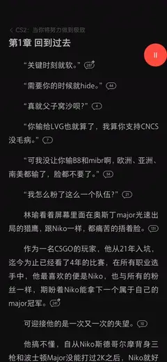
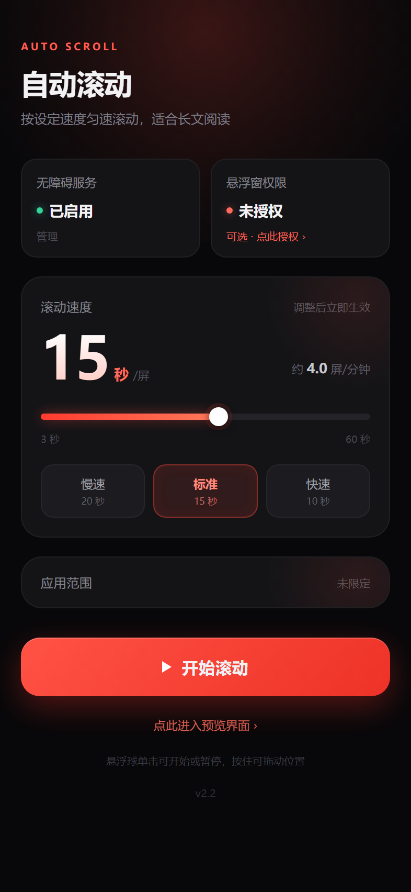
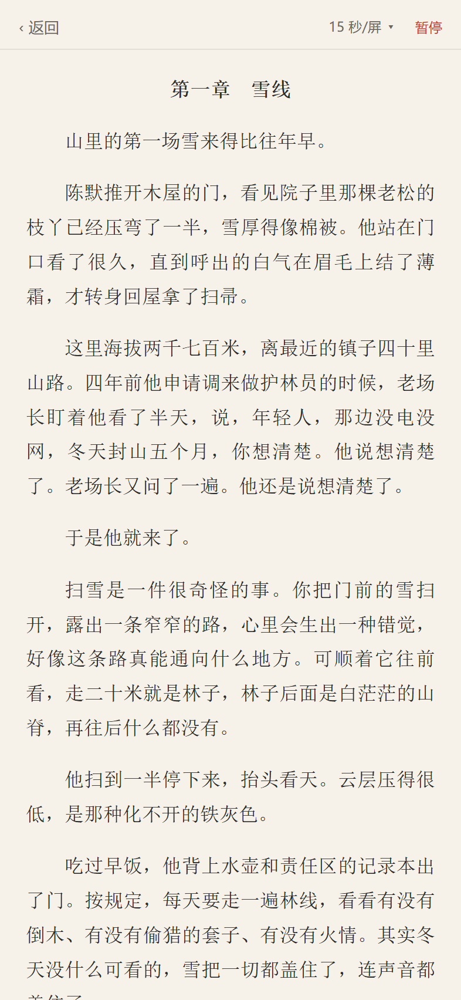

<a name="readme-top"></a>

<p align="center">
  
</p>

<p align="center">
  <a href="../../releases">下载</a> ·
  <a href="#安装">安装</a> ·
  <a href="#使用">使用</a> ·
  <a href="#常见问题">常见问题</a> ·
  <a href="#贡献">反馈</a>
  &nbsp;|&nbsp;
  <a href="README_EN.md">English</a>
</p>

<p align="center">
  &nbsp;
  &nbsp;
  &nbsp;
  
</p>

<p align="center">
  &nbsp;&nbsp;&nbsp;&nbsp;
  &nbsp;&nbsp;&nbsp;&nbsp;
  
</p>

<p align="center"><sub>滚动效果（3 秒/屏） · 设置界面 · 内置预览</sub></p>

---

## 📖 简介

AutoScroll 是一个 Android 无障碍服务应用，通过手势注入让屏幕以恒定速度向上滚动。主要面向小说、长文等需要持续阅读的场景，可在任意支持上下滚动的应用中工作。

> 不读取屏幕内容，不采集数据，不依赖网络或 root 权限。代码量小，可自行审计。

## ✨ 功能

- **匀速滚动** —— 速度以「一屏用时」表示，3～60 秒可调，全区间速度误差为 0
- **悬浮球控制** —— 单击开始或暂停，可拖动至任意位置；闲置数秒后半透明，触摸即恢复
- **内置预览页** —— 使用内置预览界面实时查看当前速度的滚动效果，无需切换应用
- **应用限定** —— 可选指定包名后仅在该应用中生效，切换应用自动暂停
- **屏幕常亮** —— 滚动期间保持唤醒，连续运行 60 分钟后自动停止

## 📱 兼容性

| 项目 | 说明 |
| --- | --- |
| 最低版本 | Android 8.0（API 26） |
| 目标版本 | Android 14（API 34） |
| 必需权限 | 无障碍服务 |
| 可选权限 | 悬浮窗（用于悬浮球控制） |
| Root | 不需要 |
| 网络 | 不使用 |

## 📦 安装

**1. 安装 APK**

从 [Releases](../../releases) 下载 `AutoScroll.apk`，传输至手机后安装。应用为自签名，系统会提示「未知来源」，允许一次即可。

**2. 启用无障碍服务**

打开应用，点击「无障碍服务」，在系统设置列表中找到「自动滚动」并启用。

**3. 授权悬浮窗（可选）**

点击「悬浮窗权限」完成授权后即可使用悬浮球。不授权亦可正常滚动，但暂停需回到应用内操作。

### 安装注意事项

**Android 13 及以上**：侧载应用首次启用无障碍时，系统可能提示「出于安全考虑，此设置当前不可用」。需在「应用信息」右上角菜单中允许受限设置，然后重新启用。

**MIUI / HyperOS**：悬浮窗存在两层开关，除系统权限外，可能还需在「应用信息 → 权限管理 → 显示悬浮窗」中单独授权。

## 🚀 使用

打开目标应用后，点击悬浮球开始滚动。需要调整速度时切回本应用拖动滑块或者选择预设，修改即时生效。

### 速度调节

速度由「一屏用时」单一参数控制，数值越小滚动越快。

| 一屏用时 | 折算速度 | 适用场景 |
| --- | --- | --- |
| 20 秒 | 3 屏/分钟 | 慢速精读 |
| **15 秒（默认）** | 4 屏/分钟 | 常规阅读 |
| 10 秒 | 6 屏/分钟 | 快速阅读 |

界面提供三档预设（慢速 20 / 标准 15 / 快速 10），滑块支持按秒微调。滑块采用对数映射而非线性映射，使常用的 10～20 秒区间占据更多行程，便于精确调节。

### 预览模式

主界面下方的「点此进入预览界面」会打开内置阅读页，内容为一段约 2000 字的原创短篇。进入后自动开始滚动，顶栏可切换速度或暂停。该页面不依赖无障碍服务，可手动滑动查看排版。

## ⚙️ 工作原理

Android 平台上实现该功能的官方接口是无障碍服务的手势注入：

```java
dispatchGesture(swipeFromBottomToTop, callback, null);
```

单次 `dispatchGesture` 是一次完整的「按下 → 移动 → 抬起」序列，发出后无法撤销或修改。因此连续滚动通过手势接力实现：一段结束后立即下发下一段。

滚动算法包含三个约束：

**固定位移，反推时长。** 每段位移约为屏高的四分之一，段时长由目标速度计算得出，使实际速度严格等于设定值，不因分段产生漂移。

**段长自适应。** 段时长在 1.5～6 秒之间随速度变化。较慢速度下衔接处丢失的位移可以忽略，较快速度下则采用更长分段以减少衔接次数。

**位移下限。** 系统 touch slop 约为 8dp，位移低于该阈值的手势会被判定为点击，从而触发目标应用自身的点击行为。因此低速时会按比例延长段时长，以同时保证位移与速度。

滚动条件的判断逻辑独立于 `ScrollPolicy`：排除本应用界面与系统界面，再匹配用户指定的包名。

更细的模块划分与设计取舍见 [docs/ARCHITECTURE.md](docs/ARCHITECTURE.md)。

## ⚠️ 已知限制

**衔接间隙**：分段之间存在几十毫秒的系统注入延迟，视觉上表现为轻微停顿（但处于可接受范围内）。该延迟由系统决定，应用无法消除。

**暂停延迟**：手势下发后不可撤销，暂停需等待当前分段结束，最长约 3.75 秒。悬浮球会立即给出状态反馈。

**无法感知滚动位置**：无障碍服务无法读取其他应用的滚动状态，页面到底后仍会持续注入手势，需手动暂停或等待自动停止。内置预览页因使用 `ScrollView` 可自行判断，到底后自动停止。

**触摸互斥**：注入的是真实触摸事件，与用户手指操作会互斥。用户可正常滑动，系统滑动会在短暂延迟后继续触发。

**厂商差异**：各 ROM 对悬浮窗、后台存活的限制策略不同，可能需要在系统权限管理中额外配置。

## ❓ 常见问题

**开启无障碍后仍然不滚动**

先确认无障碍服务列表里「自动滚动」处于开启状态（部分系统会在后台清理时自动关闭）。其次检查「应用范围」是否填了包名却与当前应用不符，主界面会显示当前前台应用，与设定不一致时提示不会滚动。

**悬浮球不显示**

悬浮窗权限未授予，或系统的悬浮窗开关是关闭的。MIUI / HyperOS 有两层开关，需要在「应用信息 → 权限管理 → 显示悬浮窗」中单独打开。

**滚动到一半自己停了**

连续运行满 60 分钟会自动停止，这是防止睡后长时间亮屏的保护。检查是否已到时限，或重新开始滚动。

**点暂停后画面还在动**

手势一旦下发就无法撤销，需等当前分段走完，最长约 3.75 秒。悬浮球会立刻变色反馈，说明点按已被接收。

**切到别的应用就不滚了**

设置了「应用范围」限定，或滚动期间系统切换到非目标应用。清空限定包名即可对所有应用生效。

**手动滑动时会被打断**

注入的是真实触摸事件，与手指操作互斥。手动滑动会短暂中断自动滚动，松手后自动恢复。需要长时间手动操作时，先点悬浮球暂停更干净。

## 🗺️ 路线图

- [ ] 连续手势（`continueStroke` 续接），消除分段之间的衔接间隙
- [ ] 设置界面整合为「更多设置」，容纳应用范围与实验性开关
- [ ] 预览页支持自定义文本导入
- [ ] 定时停止（设定分钟数后自动结束，替代固定的 60 分钟上限）

有想加的功能可以开 Issue 讨论。

## 🔨 构建

项目使用 `aapt2 + javac + d8 + apksigner` 手工构建，不依赖 Gradle 或 Android Studio。

### 环境要求

- JDK 17 或更高
- Android SDK：`platforms;android-34`、`build-tools;34.0.0`

```bash
sdkmanager "platforms;android-34" "build-tools;34.0.0"
```

### 构建命令

```bash
export ANDROID_SDK_ROOT=/path/to/android-sdk
bash build.sh
```

产物位于 `build/AutoScroll.apk`。首次运行会自动生成 `keystore.jks`（密码均为 `autoscroll`），该文件已被 `.gitignore` 排除，发布正式版本时应替换为自己的签名。

## ✅ 测试

```bash
export ANDROID_SDK_ROOT=/path/to/android-sdk
bash run-checks.sh
```

该脚本依次执行 Android Lint 与全部单元测试，也可单独运行：

```bash
cd test-jvm && ./gradlew testDebugUnitTest
```

测试工程位于 `test-jvm/`（AGP + Robolectric），其源码目录指向 `../src` 与 `../res`，与被测的构建产物为同一份代码。`test-jvm/local.properties` 中的 `sdk.dir` 需指向本机 SDK 路径。

当前状态：Lint 无警告，60 项测试全部通过。

| 测试类 | 用例数 | 覆盖范围 |
| --- | --- | --- |
| `ScrollMathTest` | 17 | 速度恒定性、位移下限、滑块映射、退避策略 |
| `ScrollPolicyTest` | 10 | 滚动条件判断（自身界面 / 系统界面 / 应用限定 / 预览态） |
| `LayoutTest` | 7 | 布局几何：尺寸、溢出、重叠、内容占屏比 |
| `MainActivityTest` | 5 | 界面文案、生命周期、主按钮状态机 |
| `PreviewActivityTest` | 6 | 预览页正文长度、可滚动高度、到底联动 |
| `ScrollServiceTest` | 6 | 服务初始化、启停状态机、重复启动保护 |
| `PrefsTest` | 9 | 参数读写往返、默认值、空值处理 |

## 🧱 技术栈

| 项目 | 选型 |
| --- | --- |
| 语言 | Java 8，不引入任何第三方运行时依赖 |
| 界面 | Android 原生 View，无 UI 框架，控件全部代码构建 |
| 构建 | `aapt2` + `d8` + `apksigner` 手工打包，不依赖 Gradle 与 Android Studio |
| 测试 | JUnit 4 + Robolectric 4.11（仅测试期依赖） |

## 📁 项目结构

```
AutoScroll/
├── AndroidManifest.xml          应用清单
├── build.sh                     构建脚本
├── run-checks.sh                Lint 与测试
├── res/                         图标与字符串资源
├── src/com/lester/autoscroll/
│   ├── MainActivity.java        设置界面
│   ├── PreviewActivity.java     内置预览页
│   ├── ScrollService.java       无障碍服务，滚动核心
│   ├── ScrollMath.java          滚动几何计算（纯 Java）
│   ├── ScrollPolicy.java        滚动条件判断（纯 Java）
│   ├── FloatPanel.java          悬浮球
│   ├── Prefs.java               参数存储
│   ├── UiKit.java               界面基础组件
│   └── PlayIconView.java        播放图标
├── test-jvm/                    测试工程（Gradle + Robolectric）
├── docs/                        文档与界面图
└── .github/workflows/           CI
```

`ScrollMath` 与 `ScrollPolicy` 不引用 Android API，可脱离设备在 JVM 上直接测试。


## 📝 更新记录

见 [CHANGELOG.md](CHANGELOG.md)。

## 🤝 贡献

反馈问题、提交改动前，请先读 [CONTRIBUTING.md](CONTRIBUTING.md)。安全问题见 [SECURITY.md](SECURITY.md)。

## 📄 许可

[MIT](LICENSE)

---

<p align="right">(<a href="#readme-top">回到顶部</a>)</p>
