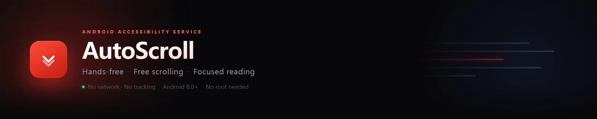

<a name="readme-top"></a>

<p align="center">
  
</p>

<p align="center">
  <a href="../../releases">Download</a> ·
  <a href="#installation">Install</a> ·
  <a href="#usage">Usage</a> ·
  <a href="#troubleshooting">Troubleshooting</a> ·
  <a href="#contributing">Feedback</a>
  &nbsp;|&nbsp;
  <a href="README.md">简体中文</a>
</p>

<p align="center">
  &nbsp;
  &nbsp;
  &nbsp;
  
</p>

<p align="center">
  &nbsp;&nbsp;&nbsp;&nbsp;
  &nbsp;&nbsp;&nbsp;&nbsp;
  
</p>

<p align="center"><sub>Scrolling (3s per screen) · Settings · Built-in preview</sub></p>

---

## 📖 Overview

AutoScroll is an Android accessibility service that scrolls the screen upward at a constant speed through simulated touch gestures. It targets long-form reading — novels, articles, anything that requires continuous scrolling — and works in any app that supports vertical scrolling.

> No screen reading, no data collection, no network access, no root. The codebase is small enough to audit.

## ✨ Features

- **Constant-speed scrolling** — Speed is expressed as seconds per screen, adjustable from 3 to 60, with zero velocity error across the entire range
- **Floating control** — Tap to start or pause, drag anywhere on screen; fades to semi-transparent when idle and restores on touch
- **Built-in preview** — A sample text screen for evaluating the current speed without switching apps
- **App scoping** — Optionally restrict scrolling to a specific package; pauses automatically when switching away
- **Screen wake** — Keeps the display on while scrolling, stops automatically after 60 minutes of continuous operation

## 📱 Compatibility

| Item | Detail |
| --- | --- |
| Minimum version | Android 8.0 (API 26) |
| Target version | Android 14 (API 34) |
| Required permission | Accessibility service |
| Optional permission | Display over other apps (for the floating control) |
| Root | Not required |
| Network | Not used |

## 📦 Installation

**1. Install the APK**

Download `AutoScroll.apk` from [Releases](../../releases) and transfer it to your device. The APK is self-signed, so the system will show an "unknown sources" prompt — allow it once.

**2. Enable the accessibility service**

Open the app, tap "Accessibility service", find "AutoScroll" in the system list and enable it.

**3. Grant overlay permission (optional)**

Tap "Display over other apps" to enable the floating control. Scrolling works without it, but pausing then requires returning to the app.

### Installation Notes

**Android 13 and above**: When enabling the accessibility service for a sideloaded app for the first time, the system may report "This setting is currently unavailable for security reasons". Allow restricted settings from the overflow menu on the App info screen, then try again.

**MIUI / HyperOS**: Overlay permission has two layers. Besides the system permission, you may also need to enable it under App info → Permissions → Display over other apps.

## 🚀 Usage

Open the target app and tap the floating control to start scrolling. To change speed, switch back to AutoScroll and drag the slider or pick a preset — changes take effect immediately.

### Speed Control

Speed is controlled by a single parameter, seconds per screen. Lower values scroll faster.

| Seconds per screen | Effective speed | Best for |
| --- | --- | --- |
| 20 s | 3 screens/min | Slow, close reading |
| **15 s (default)** | 4 screens/min | General reading |
| 10 s | 6 screens/min | Fast reading |

Three presets are available (Slow 20 / Standard 15 / Fast 10), and the slider allows per-second adjustment. The slider uses a logarithmic rather than linear mapping, giving the commonly used 10–20 second range more travel for finer control.

### Preview Mode

"Open preview" below the main button opens a built-in reading screen containing an original short story of roughly 2,000 Chinese characters. Scrolling starts automatically; the top bar allows switching speed or pausing. This screen does not require the accessibility service and can be scrolled manually to inspect the layout.

## ⚙️ How It Works

The only official API for this on Android is gesture injection from an accessibility service:

```java
dispatchGesture(swipeFromBottomToTop, callback, null);
```

A single `dispatchGesture` call is one complete press → move → release sequence, and it cannot be cancelled or modified once dispatched. Continuous scrolling is therefore implemented as a chain: as soon as one segment completes, the next is dispatched.

The scrolling algorithm maintains three constraints:

**Fixed travel, derived duration.** Each segment moves about a quarter of the screen height, with the duration computed from the target speed. Actual velocity therefore matches the configured value exactly and does not drift as a result of splitting.

**Adaptive segment length.** Duration varies between 1.5 and 6 seconds with speed. At slow speeds the displacement lost at the seam is negligible; at fast speeds longer segments reduce the number of seams.

**Minimum travel distance.** The system touch slop is about 8dp. A gesture travelling less than that is classified as a tap, which would trigger the target app's own click behaviour. Segment duration is therefore extended at low speeds to preserve both travel distance and velocity.

The decision of whether to scroll at all lives in `ScrollPolicy`: exclude the app's own UI and system windows, then match the user-specified package.

For module boundaries and design trade-offs, see [docs/ARCHITECTURE.md](docs/ARCHITECTURE.md).

## ⚠️ Known Limitations

**Seam gap**: A system injection delay of a few tens of milliseconds exists between segments, perceived as a slight pause (within acceptable range in practice). The delay is imposed by the platform and cannot be eliminated by the app.

**Pause latency**: A dispatched gesture cannot be cancelled, so pausing waits for the current segment to finish — at most about 3.75 seconds. The floating control changes state immediately to confirm the tap.

**No scroll position awareness**: The accessibility service cannot read other apps' scroll state. After reaching the end of a page, gestures keep being injected, so pausing manually or waiting for the automatic stop is required. The built-in preview screen uses a `ScrollView` and can detect the end itself, stopping automatically.

**Touch interference**: Injected events are real touch events and are mutually exclusive with finger input. Manual scrolling works, and automatic scrolling resumes shortly after release.

**Vendor differences**: ROMs differ in how they restrict overlay permission and background execution; additional configuration in system settings may be required.

## ❓ Troubleshooting

**Nothing scrolls after enabling accessibility**

Confirm "AutoScroll" is still enabled in the accessibility service list — some systems disable it during background cleanup. Also check whether "App scoping" contains a package name that does not match the current app; the main screen shows the current foreground package and indicates when it will not scroll.

**The floating control does not appear**

Overlay permission was not granted, or the system-level overlay switch is off. MIUI / HyperOS has two layers and requires enabling it under App info → Permissions → Display over other apps.

**Scrolling stops by itself**

Continuous operation stops after 60 minutes as protection against leaving the screen on. Check whether that limit was reached, then start again.

**The screen keeps moving after pausing**

A dispatched gesture cannot be cancelled, so the current segment must finish — up to about 3.75 seconds. The floating control changes colour immediately, indicating the tap was received.

**Scrolling stops after switching apps**

An app scope is configured, or the system moved to a non-target app. Clear the package name to scroll everywhere.

**Manual scrolling interrupts automation**

Injected events are real touch events and conflict with finger input. Manual scrolling briefly interrupts automation, which resumes on release. For longer manual interaction, pausing via the floating control is cleaner.

## 🗺️ Roadmap

- [ ] Continuous gesture (`continueStroke` continuation) to eliminate the seam gap between segments
- [ ] Consolidate settings into a "More settings" section holding app scope and experimental toggles
- [ ] Import custom text into the preview screen
- [ ] Timed stop (end after N minutes, replacing the fixed 60-minute cap)

Feature requests are welcome as issues; there is no guarantee everything will be implemented.

## 🔨 Building

The project builds with `aapt2 + javac + d8 + apksigner` directly, without Gradle or Android Studio.

### Requirements

- JDK 17 or newer
- Android SDK: `platforms;android-34`, `build-tools;34.0.0`

```bash
sdkmanager "platforms;android-34" "build-tools;34.0.0"
```

### Build Command

```bash
export ANDROID_SDK_ROOT=/path/to/android-sdk
bash build.sh
```

The APK is written to `build/AutoScroll.apk`. The first run generates a `keystore.jks` (password `autoscroll` for both store and key). That file is excluded by `.gitignore`; replace it with your own signing key for any real distribution.

## ✅ Testing

```bash
export ANDROID_SDK_ROOT=/path/to/android-sdk
bash run-checks.sh
```

This runs Android Lint followed by the full unit test suite. Tests can also be run directly:

```bash
cd test-jvm && ./gradlew testDebugUnitTest
```

The test project lives in `test-jvm/` (AGP + Robolectric). Its source directories point at `../src` and `../res`, so it compiles and tests exactly the same code that ships in the APK. Set `sdk.dir` in `test-jvm/local.properties` to your local SDK path.

Current status: no lint warnings, 60 tests passing.

| Test class | Cases | Coverage |
| --- | --- | --- |
| `ScrollMathTest` | 17 | Velocity consistency, minimum travel, slider mapping, retry backoff |
| `ScrollPolicyTest` | 10 | Scroll gating (own UI / system UI / app scope / preview mode) |
| `LayoutTest` | 7 | Layout geometry: sizes, overflow, overlap, screen fill ratio |
| `MainActivityTest` | 5 | UI strings, lifecycle, main button state machine |
| `PreviewActivityTest` | 6 | Preview body length, scrollable height, end-of-page handling |
| `ScrollServiceTest` | 6 | Service initialisation, start/stop state machine, duplicate start protection |
| `PrefsTest` | 9 | Preference round-trips, defaults, null handling |

## 🧱 Tech Stack

| Item | Choice |
| --- | --- |
| Language | Java 8, no third-party runtime dependencies |
| UI | Native Android Views, no UI framework, all widgets built in code |
| Build | `aapt2` + `d8` + `apksigner`, no Gradle or Android Studio required |
| Testing | JUnit 4 + Robolectric 4.11 (test-time only) |

## 📁 Project Structure

```
AutoScroll/
├── AndroidManifest.xml          App manifest
├── build.sh                     Build script
├── run-checks.sh                Lint and tests
├── res/                         Icons and string resources
├── src/com/lester/autoscroll/
│   ├── MainActivity.java        Settings screen
│   ├── PreviewActivity.java     Built-in preview screen
│   ├── ScrollService.java       Accessibility service, scrolling core
│   ├── ScrollMath.java          Scroll geometry (pure Java)
│   ├── ScrollPolicy.java        Scroll gating (pure Java)
│   ├── FloatPanel.java          Floating control
│   ├── Prefs.java               Preference storage
│   ├── UiKit.java               UI building blocks
│   └── PlayIconView.java        Play icon
├── test-jvm/                    Test project (Gradle + Robolectric)
├── docs/                        Docs and screenshots
└── .github/workflows/           CI
```

`ScrollMath` and `ScrollPolicy` reference no Android APIs, so they can be tested on the JVM without a device.


## 📝 Changelog

See [CHANGELOG.md](CHANGELOG.md).

## 🤝 Contributing

Please read [CONTRIBUTING.md](CONTRIBUTING.md) before reporting issues or submitting changes. For security matters, see [SECURITY.md](SECURITY.md).

## 📄 License

[MIT](LICENSE)

---

<p align="right">(<a href="#readme-top">Back to top</a>)</p>
